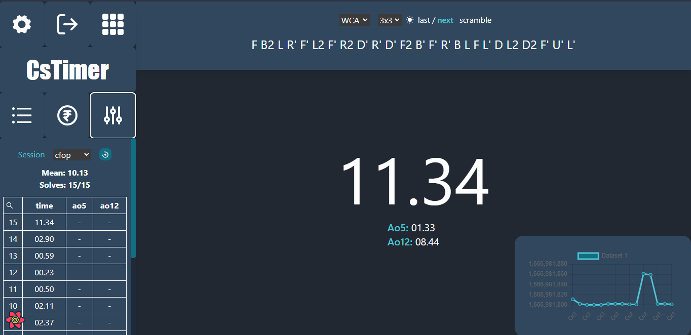

# ⌚ CsTimer

> Professional Rubik's Cube Speedsolving/Training Timer

A full-featured speedcubing timer web app inspired by [cstimer.net](https://cstimer.net), built with a modern full-stack architecture.

Cstimer is a rubik's cube timer web application it can calculate mean, averages, create sessions as well as show graphs for analytics.It have support for various puzzles like 2x2, 3x3, 4x4, 5x5, 6x6 and 7x7.



## 🪶 Features covered

-   📱 Supports multiple puzzles like 2x2, 3x3 upto 7x7.
-   📈 Displays charts to show improvement over time.
-   ✒️ Create sessions to organize your solves.
-   🧠 Generates random scrambles with my own unique algorithm.
-   ✅ OK / +2 / ❌ DNF solves
-   🖋️ Calculates mean, averages of 5, 12 and over all mean and average of the session
-   🔒 Authentication support
-   🔒 Google and Github OAuth

## ⚙️ Technologies used

-   🌐 Frontend

    -   ⏭️ Next Js
    -   📨 Axios
    -   📈 Chart Js
    -   📅 Day Js
    -   🔠 Formik
    -   🌏 Zustand
    -   🎨 Sass
    -   🪣 Tailwindcss
    -   🧠 Headless UI
    -   🧯 React Query
    -   💥 Framer motion
    -   🧊 Typescript

-   🛜 Backend
    -   📌 Nest Js
    -   📨 Rest API
    -   📗 Prisma ORM
    -   🐘 PostgresSQL
    -   #️⃣ Argon2
    -   🚇 Redis
    -   🐋 Docker
    -   ✒️ Sessions
    -   📫 Node mailer
    -   ⚙️ Dotenv - Supports environment variables
    -   🦋 Prettier - Opinionated Code Formatter

## 📁 Project Structure

```
├── assets
│   └── cstimer.png
├── client
│   ├── @types/
│   ├── api/
│   ├── components/
│   ├── global/
│   ├── hooks/
│   ├── interfaces/
│   ├── pages/
│   ├── public/
│   ├── store/
│   ├── styles/
│   ├── utils/
│   ├── .env.example
│   ├── next-env.d.ts
│   ├── next.config.js
│   ├── package.json
│   ├── postcss.config.js
│   ├── tailwind.config.js
│   ├── tsconfig.json
│   └── yarn.lock
├── server
│   ├── prisma/
│   ├── src/
│   ├── test/
│   ├── typings/
│   ├── .env.example
│   ├── Dockerfile
│   ├── docker-compose.yml
│   ├── nest-cli.json
│   ├── package.json
│   ├── tsconfig.build.json
│   ├── tsconfig.json
│   └── yarn.lock
├── .gitignore
├── LICENSE
├── README.md
```

## 🚶🏻‍♂️ Getting started and 🏃🏻‍♂️ Running the app

```bash
# 1. Clone the repository
$ git clone https://github.com/naman22a/cstimer

# 2. Enter your newly-cloned folder.
$ cd cstimer

# 3. Create Environment variables files in both client and server folder.
$ cp .env.example .env

# 4. Move into client folder
$ cd client

# 5. Install client side dependencies
$ yarn install

# 6. Start the next js server
$ yarn dev

# 7. In a new terminal move into server folder
$ cd server

# 8. Run Docker Compose
$ docker compose up

# 9. Stop Docker Compose
$ docker compose down
```

## 🤝 Contributions

Contributions, issues, and suggestions are welcome! Feel free to fork the repository and submit pull requests.

## 📫 Stay in touch

-   Author - [Naman Arora](https://namanarora.xyz)
-   Twitter - [@naman_22a](https://twitter.com/naman_22a)

## 🗒️ License

CsTimer is [GPL V3](./LICENSE)
